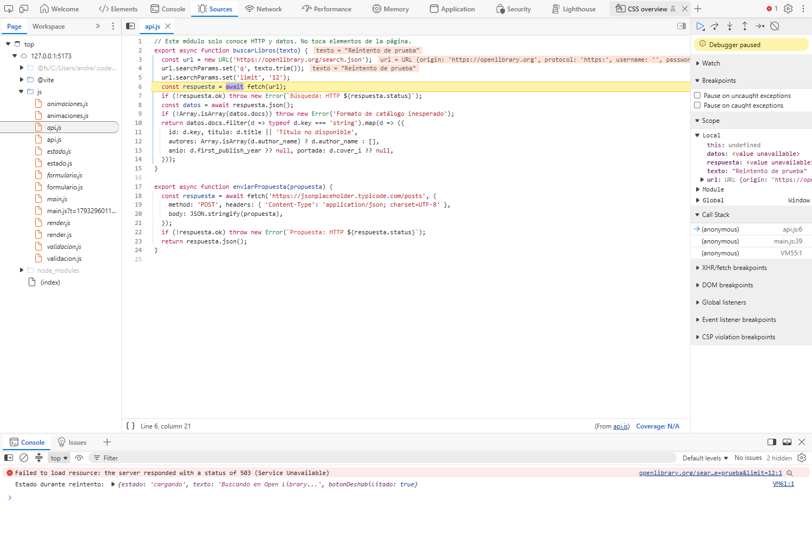
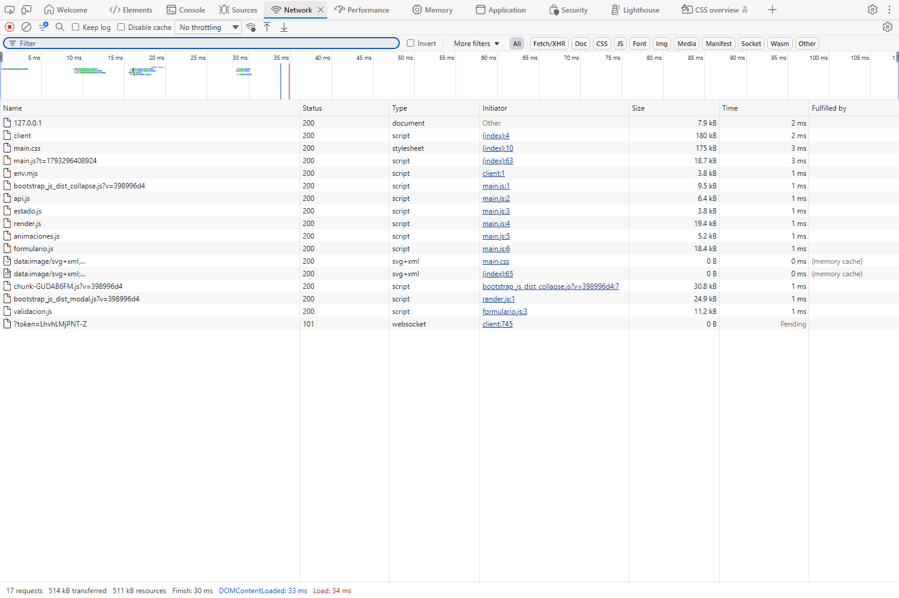

# Depuración y rendimiento

Comprobaciones realizadas el 29 de octubre de 2026 con Windows, Node.js 24.19.0, Vite 7.3.7 y Microsoft Edge. Las capturas y mediciones de esta carpeta se generaron en esta revisión. No se presentan como evidencia del desarrollo original del estudiante.

## Error real y punto de interrupción

**Síntoma:** después de una búsqueda fallida, al reintentar aparecía «Buscando en Open Library...», pero el atributo `data-estado` del aviso seguía indicando `error`. El texto visible y el estado expuesto por el DOM eran inconsistentes durante la carga.

**Reproducción:** provocar una respuesta HTTP 503 en Open Library y volver a enviar el formulario. Se simuló ese HTTP para reproducir el caso de forma determinista; no se atribuye una caída real al servicio. Las capturas muestran ese 503 intencional en la consola.

**Localización:** se fijó un punto de interrupción en [api.js](../buscador-js/js/api.js), en la línea `const respuesta = await fetch(url)`. Con la ejecución pausada se inspeccionaron el atributo del aviso, su texto y el botón de búsqueda mediante la consola de DevTools y `Debugger.evaluateOnCallFrame` del protocolo de depuración del navegador. La pila conduce al manejador del formulario en `main.js`.

El resultado fue `{ estado: 'error', texto: 'Buscando en Open Library...', botonDeshabilitado: true }`. Registro de la pausa y expresión evaluada: [debug-antes.json](capturas/debug-antes.json).

**Causa:** el manejador actualizaba el atributo al finalizar con resultados o error, pero no al iniciar la siguiente búsqueda.

**Corrección:** en [main.js](../buscador-js/js/main.js) se asigna `mensaje.dataset.estado = 'cargando'` antes de llamar a la API. El HTML declara el estado inicial y el envío sin texto lo restablece. Los estados de resultados, vacío y error se conservan al resolver la petición.

La misma inspección devuelve `{ estado: 'cargando', texto: 'Buscando en Open Library...', botonDeshabilitado: true }`; véase [debug-despues.json](capturas/debug-despues.json). Para capturar el «antes» se reprodujo temporalmente la omisión original y después se restauró la corrección. Las capturas son del inspector real, no imágenes reconstruidas. La prueba de regresión comprobó error, reintento en carga y resultados, además de la habilitación del botón.

## Panel de red

Escenario: carga inicial de la Parte A en desarrollo, 1365 × 900 px, caché desactivada, sin buscar ni desplazarse. Se cuentan peticiones HTTP; se excluyen WebSocket de Vite y recursos `data:`. No se cargan portadas remotas en este escenario.

| Métrica | Bootstrap completo | Bootstrap selectivo |
|---|---:|---:|
| Peticiones HTTP | 14 | 14 |
| Transferencia total, con encabezados | 575.562 bytes | 514.304 bytes |
| CSS generado antes de compresión HTTP | 235.676 bytes | 174.418 bytes |

Datos nuevos registrados con `Network.requestWillBeSent` y `Network.loadingFinished`: [mediciones.json](capturas/mediciones.json). El panel es una captura complementaria de la carga selectiva; la tabla procede de los eventos del protocolo de red. Los tamaños incluyen los módulos y cliente de Vite, por lo que no representan el peso del build de producción con gzip.

## Optimización y comparación

Se usan únicamente los parciales necesarios de Bootstrap en [scss/main.scss](../buscador-js/scss/main.scss), manteniendo sus dependencias, grilla, utilidades y los seis componentes requeridos. La variante de comparación importa Bootstrap completo usando las mismas variables y estilos propios. Se compilaron y midieron ambas variantes y se restauró la versión selectiva al terminar.

El CSS se redujo **61.258 bytes (25,99 %)** y el total transferido **10,64 %**; permanecieron 14 peticiones. Esta comparación mide bytes, no acredita una reducción del tiempo de carga. Se importan únicamente los comportamientos Modal y Collapse, se declaran dimensiones de portadas y se usa carga diferida de imágenes; no se atribuye a estas medidas la reducción cuantificada del CSS.

## Verificación funcional

Se ejecutaron 6 pruebas unitarias y 6 recorridos de interfaz, todos satisfactorios. Cubrieron duplicados, ciclo completo de estados, inmutabilidad, fechas locales, normalización y errores de API, longitudes máximas de React, DOM seguro ante texto con etiquetas, modal, delegación sobre descendientes, límites y envío de cinco autores, año futuro, fecha pasada, error y reintento, filtros y conteos compartidos, alta, baja y diseño de ambas partes a 320 px. No se detectaron excepciones de página en los recorridos normales; los errores HTTP de las pruebas fueron intencionales.

Se ejecutó `npm run build` para las dos aplicaciones con resultado satisfactorio. La validación de React también comprueba en JavaScript los máximos de 180 caracteres de título y 200 de autores, coherentes con las restricciones del formulario.

El 12 de noviembre de 2026 se repitieron las 6 pruebas unitarias, los 6 recorridos de interfaz y la compilación de ambas aplicaciones tras una revisión de legibilidad. Todo pasó. Las capturas y mediciones de red anteriores corresponden a la revisión original; no se presentan como nuevas mediciones.

En una comprobación independiente sin simular las APIs, Open Library devolvió 12 resultados para «Carmen Lyra», primero «Los cuentos de mi tía Panchita», y el POST a JSONPlaceholder devolvió id 101. Resultado: [servicios-reales.json](capturas/servicios-reales.json). Esta respuesta no significa persistencia real. La Parte B utiliza únicamente el módulo local de datos.

## Alcance de la evidencia

Las pruebas y capturas acreditan las comprobaciones actuales, no el historial de desarrollo ni la autoría individual. El ZIP carecía de historial Git. No se pueden autenticar quince commits distribuidos durante el período, una entrega anterior a la fecha límite ni las capturas históricas incluidas en el ZIP; estas últimas se excluyeron de esta entrega y se sustituyeron por evidencias nuevas. La defensa individual debe realizarla el estudiante.
